<picture><source media="(prefers-color-scheme: dark)" srcset="assets/hero-dark.svg"></picture>

<picture><source media="(prefers-color-scheme: dark)" srcset="assets/stack-dark.svg"></picture>

<a href="https://github.com/Joxquin/NotiVas-KMP"><picture><source media="(prefers-color-scheme: dark)" srcset="assets/project-notivas-kmp-dark.svg"></picture></a>

<a href="https://github.com/Joxquin/NotiVas"><picture><source media="(prefers-color-scheme: dark)" srcset="assets/project-notivas-dark.svg"></picture></a>

<a href="https://github.com/Joxquin/antigravity-android"><picture><source media="(prefers-color-scheme: dark)" srcset="assets/project-antigravity-android-dark.svg"></picture></a>

<a href="https://github.com/Joxquin/djangoApp11"><picture><source media="(prefers-color-scheme: dark)" srcset="assets/project-djangoapp11-dark.svg"></picture></a>

<picture><source media="(prefers-color-scheme: dark)" srcset="assets/stats-dark.svg"></picture>

<picture><source media="(prefers-color-scheme: dark)" srcset="assets/streak-dark.svg"></picture>

<picture><source media="(prefers-color-scheme: dark)" srcset="assets/wave-dark.svg"></picture>

<a href="https://metawka.github.io/expressive-profile/?from=Joxquin"><picture><source media="(prefers-color-scheme: dark)" srcset="assets/credit-dark.svg"></picture></a>

